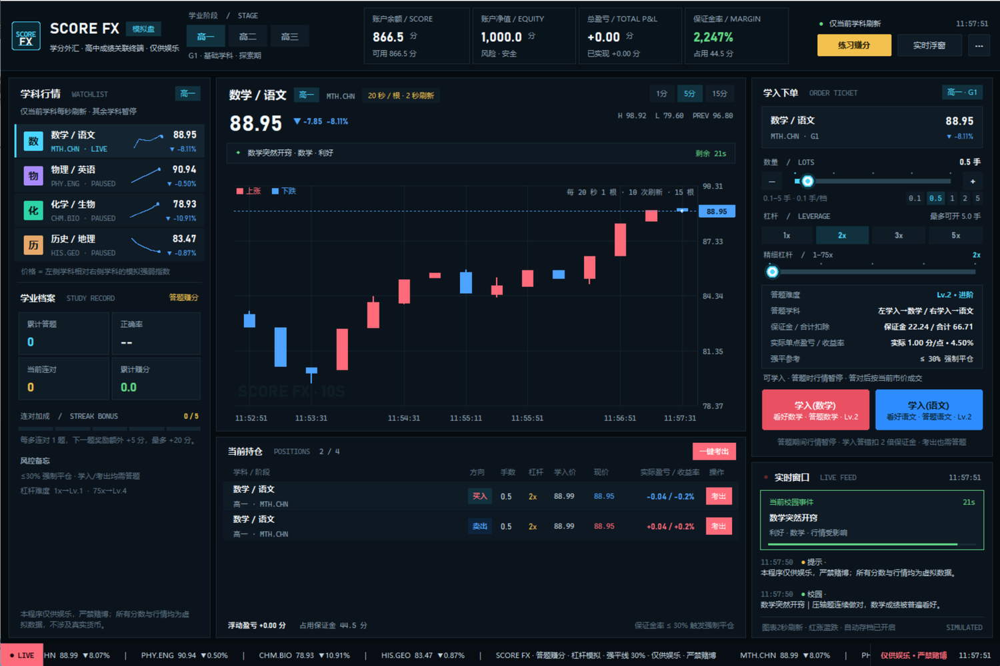
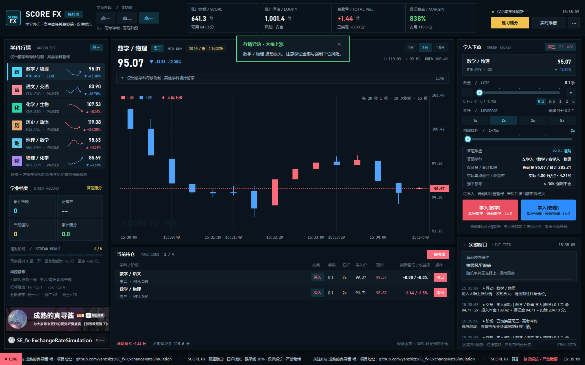
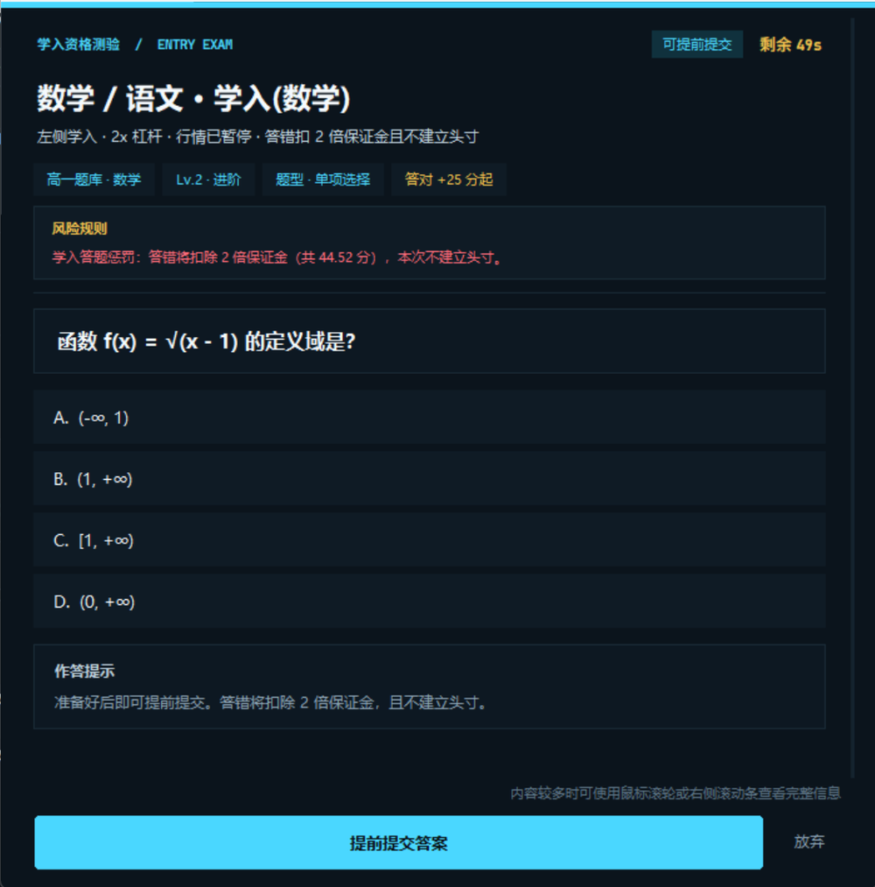
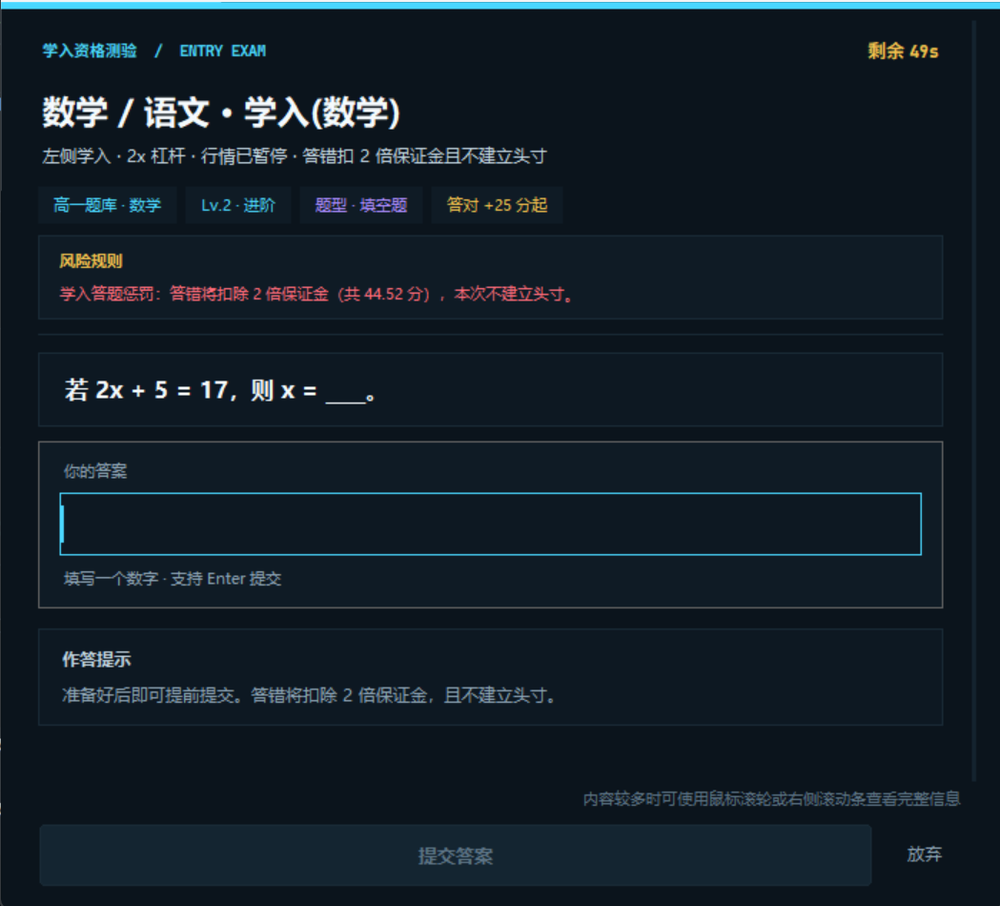
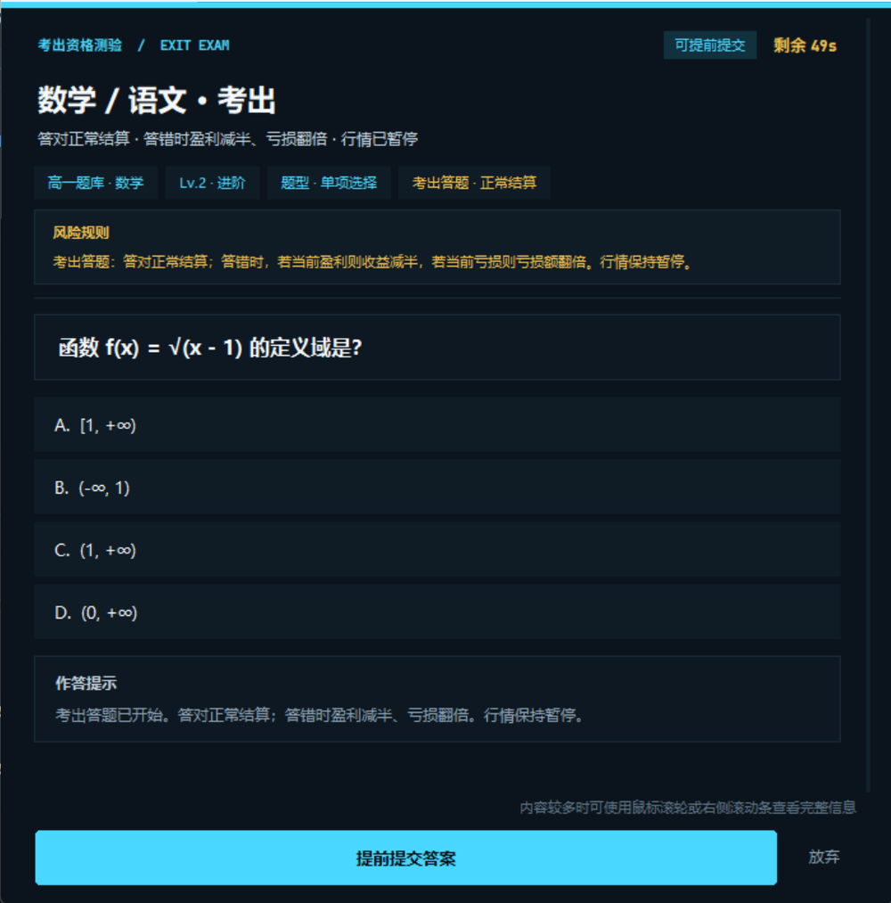
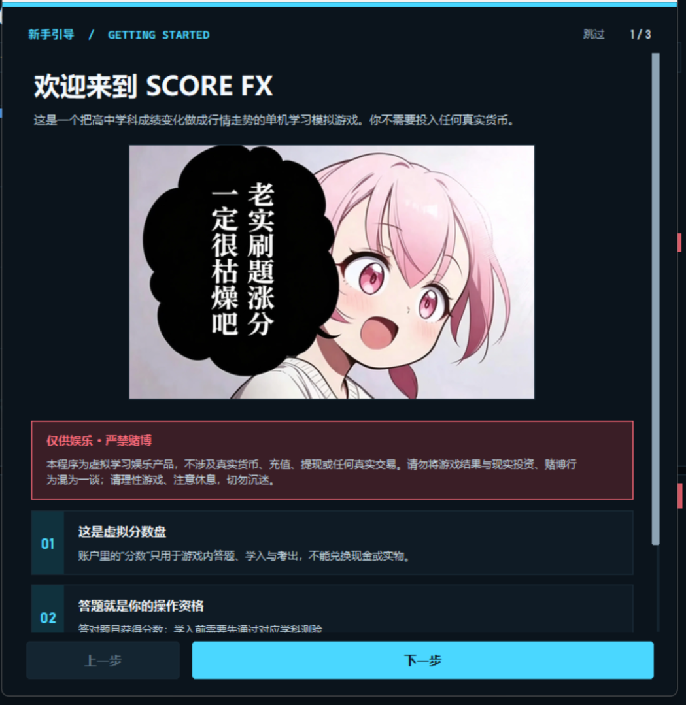
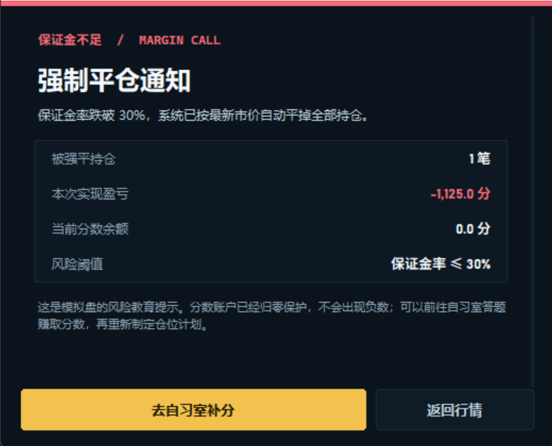
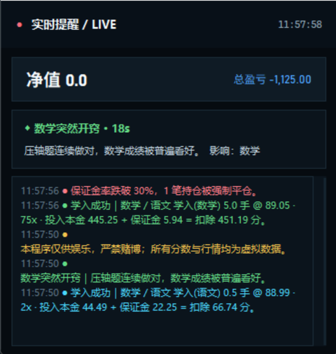

# SCORE FX · 学分汇

一款跟适合中国宝宝体制游玩的另类游戏

它参考了《FX 战士久留美》那种行情软件的操作感：左侧行情、中间**每 20 秒一根、2 秒刷新**的细蜡烛分时图、右侧学入、实时快讯、保证金率和强平线一应俱全。但这里交易的不是货币，而是学科组合，例如：

- **数学 / 语文**：数学成绩相对语文成绩的“强弱指数”
- **物理 / 英语**：物理成绩相对英语成绩的“强弱指数”
- **化学 / 生物**、**历史 / 政治**、**地理 / 数学** 等

价格涨，表示左侧学科相对右侧学科更“强”。点击「学入(数学)」表示看好数学，点击「学入(语文)」表示看好语文；学入前需要答对应学科的题。持仓通过红色的「考出」按钮答题后结算。只有当前选中的学科对会实时刷新，学入/考出答题和新手引导期间全市场行情暂停。最大杠杆 75x，行情会随机出现连续大涨或大跌。进度会自动存档，下次打开可以接着玩。

> **本程序仅供娱乐，严禁任何形式的赌博。** 所有行情、分数、盈亏与随机事件均为模拟数据，不涉及真实货币、充值、提现、真实证券或真实外汇交易，也不能兑换任何现实财物。请理性游戏、注意休息，切勿沉迷。




## 核心玩法

### 1. 三个学业阶段

顶部的「高一 / 高二 / 高三」按钮用于切换行情层次。不同阶段使用不同的学科对、不同波动率和答题奖励倍率：

| 阶段 | 市场特点 | 波动率 | 奖励倍率 | 学科对数量 |
|---|---|---|---|---|
| 高一 | 基础学科 · 探索期 | 0.86 | 1.00 | 4 |
| 高二 | 文理分化 · 波动加剧 | 1.08 | 1.15 | 5 |
| 高三 | 高考冲刺 · 高危阶段 | 1.38 | 1.30 | 6 |

切换阶段不会清空账户；已有持仓会继续跟踪它所属阶段的行情，持仓列表里会显示「高一 / 高二 / 高三」标记。

**交易分数倍率：**

- 高一：×1，标准学入与结算；
- 高二：×5，保证金、合计扣除、盈亏、惩罚等交易金额放大 5 倍；
- 高三：×20，交易金额放大 20 倍。

倍率只作用于该年级的**交易金额**，题目奖励和「练习赚分」不乘倍率；价格、公式和答题难度本身不变。

### 2. 20 秒细蜡烛分时图与暂停

- 主图每 **2 秒刷新一次**；累计 **10 次刷新（约 20 秒）形成一根新蜡烛**。
- 当前柱的收盘价高于开盘价时显示为**红色**，低于开盘价时显示为**蓝色**。
- 每根蜡烛都带有上下**细影线**；当前未满 20 秒的柱会带有一个小端点，突出显示实时变化。
- 价格趋势约为 9–11 秒一段；行情会随机进入**连续大涨、连续大跌、交叉波动**，并可能持续较长时间。
- 大约三成的新趋势段会进入“大幅波动”状态，偶尔还会出现额外冲击；图例会显示「⚡ 大幅上涨 / 大幅下跌」。
- **只有当前选中学科**会实时刷新；左侧其他学科标注 `PAUSED`，价格保持不变。
- 行情图会铺满卡片左右两侧；全屏时每条蜡烛实体进一步加宽，减少细条带来的视觉疲劳。
- 横坐标标签数量会随可用宽度增加，避免全屏时标签过疏；按 `F11` 或从 `⋯` 菜单可切换全屏。
- 进入答题窗口或新手引导时，行情会暂停；关闭后恢复。
- 时间窗口按钮：`1分 / 5分 / 15分`，分别展示约 3 / 15 / 45 根 20 秒蜡烛。

### 3. 学入 = 答题 + 结算规则

右侧「学入下单」面板：

- 选择数量：0.1–5.0 手，0.1 手为一档。可拖动高亮滑杆、点击快捷档位或使用 `− / +`。
- 选择杠杆：`1x / 2x / 3x / 5x` 快捷按钮，**下方另有 1–75x 精细滑动选择**。
- 点击 **学入(左侧学科)** 或 **学入(右侧学科)**。
- 两个按钮在底层仍分别对应原来的做多 / 做空方向，但界面改为学科主题：
  - `学入(数学)`：看好数学，参加数学测验；
  - `学入(语文)`：看好语文，参加语文测验；
  - 其他学科对会根据当前科目自动替换括号内名称。

程序会按杠杆弹出学科测验：

| 杠杆 | 题目难度 | 限时 |
|---|---|---|
| 1x | Lv.1 基础 | 45 秒 |
| 2–3x | Lv.2 进阶 | 50 秒 |
| 4–9x | Lv.3 挑战 | 55 秒 |
| 10–75x | Lv.4 竞赛 | 60 秒 |

- **学入(左侧学科)** 时，考左侧学科；**学入(右侧学科)** 时，考右侧学科。
- 选择题和判断题在选定选项后，可以点击 **「提前提交答案」** 立即交卷，不需要等待倒计时结束。
- 题目来自当前所在年级的题库：高一、高二、高三各有抽题池，基础题共用，年级专属题独立。
- 弹窗内容较多时支持鼠标滚轮和右侧滚动条，保证题目、选项、解析和风险提示都能完整查看。
- **答对**：奖励直接进入账户分数余额。点击「确认学入」后，账户扣除 **投入资金 + 保证金**，并按暂停时的市价建立头寸。
- **答错或超时**：本次学入取消，扣除 **2 倍保证金**，不建立头寸。
- 答题时全市场暂停；题目答案与解析会在提交后显示。
- 持仓按钮为 **「考出」**，顶部为 **「一键考出」**，均为红色按钮。
- **考出也需要答题**，并按以下规则结算：
  - **答题正确**：正常结算，返还投入本金与保证金，并按杠杆结算盈亏；
  - **答题错误且当前盈利**：收益减半；
  - **答题错误且当前亏损**：亏损额翻倍；
  - **答题错误且盈亏为 0**：只返还本金与保证金。
- 考出答题同样支持提前提交；答题期间行情暂停。
- 最多同时持有 4 笔持仓。

### 4. 账户、保证金与实际结算

程序顶部的账户栏始终显示：

- **账户余额**：已扣除持仓投入本金和保证金后的自由分数。
- **账户净值**：账户余额 + 全部持仓当前价值（包含本金、保证金和浮动盈亏）。
- **总盈亏**：已实现盈亏 + 浮动盈亏。
- **保证金率**：账户净值 ÷ 占用保证金。
- **可用金额**：账户余额，可直接用于下一笔学入。

主要计算：

```text
投入资金 = 学入价 × 数量
保证金   = 投入资金 ÷ 杠杆
投入分数 = 投入资金 + 保证金
杠杆前盈亏 = (当前价 − 学入价) × 方向 × 数量
实际浮动盈亏 = 杠杆前盈亏 × 杠杆
结算分数 = 投入分数 + 实际浮动盈亏
收益率   = 实际浮动盈亏 ÷ 保证金
账户净值 = 账户余额 + 持仓当前价值
保证金率 = 账户净值 ÷ 占用保证金
```

- 数量直接参与计算，不再乘隐藏的合约倍数。
- 学入答题错误扣除 **2 倍保证金**。
- 考出答题错误时：
  - 实际为亏损：实际亏损额再 ×2；
  - 实际为盈利：实际盈利额再 ÷2。
- 持仓列表同时显示实际盈亏和收益率。
- 最大杠杆为 **75x**。
- 风险规则：
  - 保证金率 ≤ **180%**：黄色风险提示。
  - 保证金率 ≤ **120%**：红色高风险提示。
  - 保证金率 ≤ **30%**：**强制平仓全部持仓**，并弹出风险控制通知。
- 分数账户最低为 0；即使遭遇极端行情也不会出现负数。

分数不够时可以随时点顶部金色按钮「练习赚分」，答对自习室题目也能补充余额。连续答对会叠加 +5 分连对加成，最多 +20 分。

### 5. 随机校园事件

行情会在运行中随机触发校园生活事件，例如：

- 「重感冒袭击」：连续低烧，全科成绩短线承压。
- 「状态火热」：复习效率奇高，整体成绩走强。
- 「数学突然开窍」「英语听力崩盘」等单科事件。
- 「手机被班主任没收」「月考排名公布」「家长会临近」「错题本丢了」等全科事件。

每个事件都有**标题、说明、利好/利空方向、受影响学科、持续时间和波动率影响**。事件持续期间会改变对应学科对的价格漂移和波动，右侧「实时窗口」会显示倒计时，事件结束后行情回归常态。

### 6. 实时窗口

- 右下角固定「实时窗口 / LIVE FEED」：显示当前校园事件、倒计时、行情播报、学入 / 考出记录、答题结果和风险提示。
- 点击顶部右侧「实时浮窗」可以打开一个**置顶小窗口**，在主界面被遮挡时仍然能看到净值、总盈亏、事件和最新消息。
- 底部有持续滚动的模拟行情走马灯。

### 7. 自动存档与重新开始

程序会把以下状态自动保存到同目录下的 `savegame.json`：

- 账户余额、已实现盈亏、持仓与学入价格；
- 三套学业阶段的行情历史、价格、进行中的校园事件；
- 答题次数、正确率、连对、累计赚分；
- 当前阶段、学科、手数、杠杆、时间周期和新手引导完成状态。

存档时机：每次学入、考出、答题、切换阶段、调整下单参数后，以及每隔约 10 秒自动保存一次；正常关闭窗口时也会保存。旧版本存档会自动升级到新的保证金/结算规则。

顶部右侧的 **`⋯`** 菜单提供：

- **立即存档**（快捷键 `Ctrl+S`）；
- **新手引导**：随时重新查看入门说明；
- **切换全屏**（快捷键 `F11`）；
- **重新开始**：二次确认后清空账户、持仓、答题记录、行情与存档，并重新显示新手引导。

### 8. 新手引导与反赌博提醒

- **首次进入软件**或**重新开始一局**时，会自动显示三页新手引导：
  1. 这是什么游戏，以及账户分数没有真实价值；
  2. 选年级、调数量 / 杠杆、学入、考出的完整流程；
  3. 保证金、强平、答题惩罚和行情波动风险。
- 新手引导第一页的「仅供娱乐 · 严禁赌博」上方会显示一张提示插画。
- 引导会暂停行情，完成后恢复；之后可在 `⋯` 菜单中再次打开。
- 我在游戏中设置了一个小彩蛋，你可以发现吗？
- 界面中固定展示以下提醒：
  - 左下角：「本程序仅供娱乐，严禁赌博；所有分数与行情均为虚拟数据，不涉及真实货币。」
  - 底部状态栏：「仅供娱乐 · 严禁赌博」。
  - 新手引导和菜单中的醒目红色警示框。
- 本程序**仅供娱乐和学习模拟**，不是真实交易软件，不提供充值、提现、兑换或任何真实金融服务，也不构成投资建议。请理性游戏、注意休息，切勿沉迷。


## 分年级题库 · 188 道题 · 4 种题型
- ***全部题目由Deepseek-pro展示，我吗那个实力***

题库分为 **高一年级题库、高二年级题库、高三年级题库**，答题时只会从当前所选年级的题库中抽题。基础题三个年级共用，另有一批年级专属题；每个年级可用题目约 **134 / 135 / 135 道**，每个年级都覆盖 9 个学科和 4 个难度等级。

同一个「年级 × 学科 × 难度」至少有 3 道基础题，另外还可能叠加年级专属题；本轮又新增了 27 道进阶题，覆盖不同年级、学科和杠杆难度。抽题时会优先避开最近做过的题，因此不会每次重复同一道题。

题库共 **188 道**，以人教版高中教材知识范围为主线组织，包含四种题型：

- 高一：必修一、必修二基础内容，以及函数、运动、物质分类、细胞等入门知识；
- 高二：选择性必修与文理分科内容，如数列、电场、化学平衡、遗传规律等；
- 高三：高考复习与综合应用，如导数、动量、电解、遗传概率、区域地理等。

- **单项选择**：4 个选项；
- **判断题**：正确 / 错误；
- **填空题**：输入文字或短语；
- **数值计算**：输入数值，按容差判定。

数学、语文、物理、英语、化学、生物、历史、政治、地理均有覆盖。题目按年级知识范围归档，并补充了对应年级的 PEP 范围题目。

每道题均包含正确答案和解析。选择题与判断题的选项顺序会在出题时随机打乱，避免靠位置背答案。题库位于 `questions.py`，可以直接追加自己的题目；新增题目时可指定 `grades` 字段限定年级。

## 快捷键

| 按键 | 功能 |
|---|---|
| `B` | 左侧学入（答左侧学科） |
| `S` | 右侧学入（答右侧学科） |
| `P` | 自习室练习赚分 |
| `F` | 打开 / 关闭实时浮窗 |
| `F11` | 切换全屏 / 窗口模式 |
| `Ctrl + S` | 立即保存当前进度 |
| `1 / 2 / 3` | 切换到高一 / 高二 / 高三 |
| `1–4`（选择/判断题内） | 选择选项 |
| `Enter`（答题窗口内） | 提交 / 继续 |
| `Esc`（答题窗口内） | 关闭答题窗口 |

## 界面预览

全屏状态（`F11` 切换，行情图铺满左右区域）：



| 学入选择题答题 | 学入填空题答题 |
|---|---|
|  |  |

| 考出答题 | 新手引导 |
|---|---|
|  |  |

| 强制平仓 | 实时浮窗 |
|---|---|
|  |  |

## 文件结构

```text
SE Warrior/
├─ score_fx.py          # 程序入口、主界面、账户交互、定时刷新
├─ engine.py            # 行情引擎、账户/杠杆/强平、随机校园事件
├─ questions.py         # 分年级 188 道混合题型题库
├─ savegame.py          # 本地自动存档、校验与恢复
├─ pulse_chart.py       # 20 秒一根、2 秒刷新的细蜡烛图
├─ widgets.py           # 行情行、答题弹窗、浮窗、确认弹窗等组件
├─ theme.py             # 深色终端配色、字体、通用绘制工具
├─ savegame.json        # 首次运行后生成的本地存档
└─ README.md            # 这个是DeepSeek写的，我太懒了，就稍微修改一下就行了，感觉deepseek知道的比我还多
```

## 自定义

- **增加题目**：在 `questions.py` 的 `RAW_QUESTIONS` 中按 `(学科, 难度等级)` 添加字典。单选题字段为 `q / options / answer / explain`；填空题和数值题使用 `type / q / answers / explain`，其中 `answers` 是可接受的多个答案。
- **增加随机事件**：在 `engine.py` 的 `EVENT_TEMPLATES` 中追加事件模板，可设置 `subjects`（空列表代表全科）、`drift`、`vol` 和 `duration`。
- **调整初始分数 / 强平线**：在 `engine.py` 顶部修改 `STARTING_BALANCE`、`MAINTENANCE_RATIO` 等常量。
- **修改学科对**：在 `engine.py` 的 `TIER_DEFS` 中配置每个阶段的价格基准和学科对。

## 说明

这是为学习、演示和游戏化反馈而做的模拟器，不是投资建议，也不是现实外汇或证券交易软件。行情由本地随机引擎生成，不连接任何外部服务器；游戏进度只保存在本机同目录的 `savegame.json` 中。

## 致谢

- **B站up主[成熟的真寻酱](https://space.bilibili.com/3546621904161633)**
- **大肥鱼的代码优化**
- **《FX战士久留美》**
